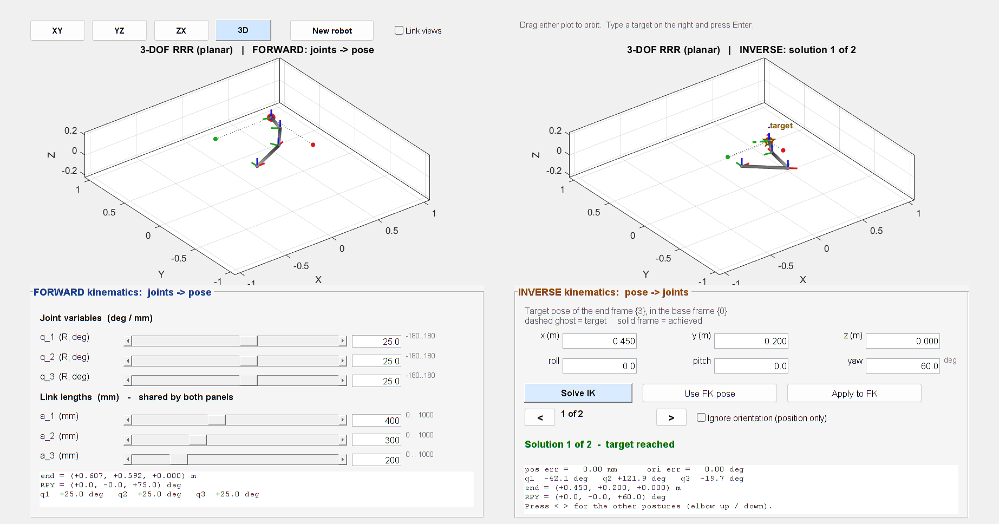
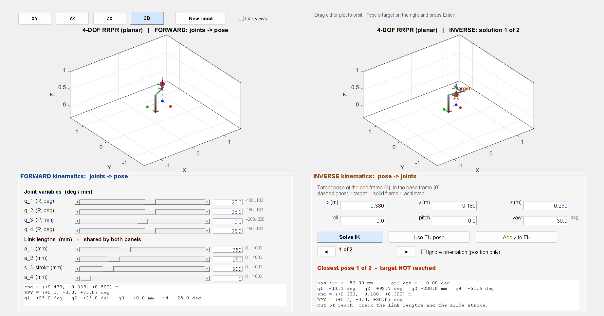

# DH Robot — Forward vs Inverse Kinematics

Two arms, one window. On the left you drive a 2–4 DOF robot with joint sliders and read the
pose of the tool frame. On the right you type the pose you *want*, and a damped-least-squares
solver finds joint values that put the same arm there. The target is drawn as a **dashed ghost
frame**, so the gap between "asked" and "achieved" is visible, not just printed.



One self-contained MATLAB script. No data files, and no toolbox besides the Robotics System
Toolbox.

---

## What the window shows

| | Left — FORWARD | Right — INVERSE |
|---|---|---|
| **Input** | joint sliders `q1..qN` (deg / mm) | typed `x y z` (m) and `roll pitch yaw` (deg) |
| **Output** | the pose of frame `{N}` | the joint vector that reaches the typed pose |
| **Direction** | joints → pose (a function) | pose → joints (not a function: several postures can share one pose) |
| **Extra** | link lengths `a_i` / stroke `s_i`, shared by both panels | the target ghost, the error readout, `< >` through the alternative solutions |

Both plots are the same robot, at the same scale, with **linked cameras** — orbit one and the
other follows, so the two postures are always compared from one viewpoint.

---

## Run it

* MATLAB **R2020b or newer** (developed and tested on **R2024b**).
* **Robotics System Toolbox** (`rigidBodyTree`, `getTransform`) — checked when the script starts.
* Put the folder on the MATLAB path and run:

```matlab
>> DH_Robot_FK_IK
```

or open the file and press **Run**. A form asks for the robot first; **Use defaults** gives a
planar 3R arm (`RRR`, lengths 0.40 / 0.30 / 0.20 m). The script prints the DH table and checks
its own DH chain against the toolbox before the window opens.

---

## The target pose

You type the pose of the end frame `{N}` **expressed in the base frame `{0}`**:

| Box | Meaning |
|-----|---------|
| `x`, `y`, `z` | position of the tool-frame origin, **metres** |
| `roll`, `pitch`, `yaw` | orientation of the tool frame, **degrees** |

The rotation convention is the usual ZYX one:

```
R = Rz(yaw) · Ry(pitch) · Rx(roll)
```

so yaw turns about the base `z` axis, pitch about `y`, roll about `x`. The achieved frame is
reported in the same convention, which makes a mismatch readable as a number as well as
visible as a tilt.

---

## How the inverse kinematics is solved

Numerically, so it works for any R/P mix the form accepts — no closed-form derivation per
robot:

* error `e = [p_target - p(q); rotvec(R_target * R(q)')]`
* step `dq = (J'*J + lambda^2*I) \ (J'*e)` — damped least squares (Levenberg–Marquardt)
* `J` is the **geometric Jacobian** built from the DH frames, not from finite differences
* **40 starts** — the current pose, the zero pose, mid-range, and 37 fixed random poses.
  Every start that reaches the pose is kept, duplicates are removed, and the solution nearest
  the current pose is shown first (least joint motion).
* joint limits are the slider limits (±180° for revolute, ±stroke for prismatic), and angles
  are wrapped to (−180°, 180°]

The damping is what makes the solver stable at a **singularity** — a fully stretched arm takes
a short, safe step instead of a huge joint jump. Because 40 starts are used, the panel usually
finds **more than one** posture for the same pose; that is what `<` and `>` step through
(elbow up / elbow down).

The solver is deterministic: the same target always gives the same set of solutions, which
matters when a class is following along.

---

## The buttons

| Control | What it does |
|---------|--------------|
| **Solve IK** | solve for the typed pose (pressing Enter in any box does the same) |
| **Use FK pose** | copy the left panel's pose into the six boxes. The target is then guaranteed reachable, so the solver must return the left panel's joint values — the cleanest check that FK and IK agree. |
| **Apply to FK** | put the selected solution on the left sliders, so both arms stand in the same pose |
| **< >** | step through the other solutions found for the same target |
| **Ignore orientation** | solve for position only — the right choice when the arm has fewer than 6 DOF |
| **XY / YZ / ZX / 3D** | set the camera of **both** plots at once (orthographic for the plane views) |
| **New robot** | change the configuration without restarting MATLAB |

---

## Reading the result

The right panel reports:

* `pos err` (mm) and `ori err` (deg) between the target and the best pose found;
* the joint vector, with the unit of each joint (`deg` or `mm`);
* the achieved pose, as position and roll/pitch/yaw.

Green **"target reached"** means the residual is below 0.2 mm and 0.1°. Orange **"target NOT
reached"** means the pose is outside the workspace, and the panel says why: beyond the arm's
reach, out of stroke, or *tick "Ignore orientation"*.



---

## Examples to try

1. **Agreement.** Press *Use FK pose*, then *Apply to FK*: the solver returns the same joint
   values and the left sliders snap back to where they were.
2. **Out of plane.** Default planar 3R, set `z = 0.30` and solve: the arm cannot leave its
   plane, so the residual is 300 mm. Tick *Ignore orientation*: the arm now gets as close as
   it can, and the ghost shows the gap.
3. **Two postures.** `x = 0.45, y = 0.20, z = 0, yaw = 60`: press `<` and `>` to flip between
   elbow-up and elbow-down.
4. **A slide at its limit.** SCARA `RRPR`, lengths `0.35 0.25 0.20 0`, offsets `0.50 0 0 0`,
   target `z = 0.25` with the shoulder at 0.50: the slide needs 250 mm but has a 200 mm stroke,
   so `q3` stops at −200 mm and the readout says 50 mm.
5. **Spatial.** `RRR`, lengths `0.40 0.30 0.20`, twists `90 0 0`.

---

## Validation

`checkcode` is clean (0 messages), and the solver was checked against the Robotics System
Toolbox and against finite differences:

| Check | Result |
|-------|--------|
| DH chain (`dhFKchain`) vs `getTransform` | identical (0.0e+00) |
| analytic Jacobian vs central differences | 3.5e-10 (linear), 1.6e-09 (angular) |
| planar 3R: FK pose → IK → FK | 1.8e-13 m, 0.0° |
| SCARA RRPR: FK pose → IK → FK | 1.6e-10 m, 0.0° |
| spatial 3R: FK pose → IK → FK | 1.8e-09 m, 0.0° |
| unreachable target | reports 300.0 mm instead of a false success |
| roll/pitch/yaw round trip | 2.0e-13 |
| a warm solve (40 starts) | about 130 ms |

---

## Files

| File | Purpose |
|------|---------|
| `DH_Robot_FK_IK.m` | The script described above — the whole tool in one file. |
| `screenshots/` | The two images used above. |
| `LICENSE` | MIT. |

---

## License

MIT — see [LICENSE](LICENSE).
